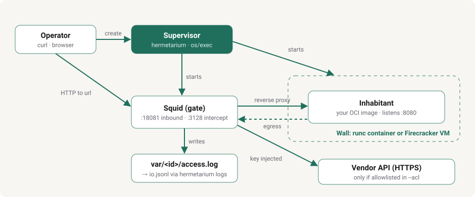

# Hermetarium

<p align="center">
  <picture>
    <source media="(prefers-color-scheme: dark)" srcset="docs/assets/hermetarium-logo-dark.svg">
    <source media="(prefers-color-scheme: light)" srcset="docs/assets/hermetarium-logo-light.svg">
    
  </picture>
</p>

[](https://github.com/pihme/hermetarium/actions/workflows/ci.yml)
[](https://github.com/pihme/hermetarium/releases?q=hermetarium)
[](https://github.com/pihme/hermetarium/releases?q=porter)
[](LICENSE)
[](https://pihme.github.io/hermetarium/)

Hermetarium is a home for a coding assistant. The assistant wakes up inside a container. It may use that container freely: a shell, packages, and files. It runs as root.

The wall is outside the container. A weak wall is Docker. A strong wall is a small virtual machine. [Squid](https://www.squid-cache.org/) is the only door. Your API key stays in the gate file, `squid.conf`, and Squid adds it as the call leaves. The habitat starts only when that door is up.

The command is `hermetarium`.

Part of [Hobelbank](https://pihme.github.io/hobelbank/), a set of projects on building software in the age of AI.

- [Website](https://pihme.github.io/hermetarium/) — handbook and current status
- [Specification](SPEC.md) — what Hermetarium is
- [Testing](TESTING.md) — what the suite checks
- [Usage guide](USAGE.md) — walls, the gate file, logs, and your own image
- [Contributing](CONTRIBUTING.md) — issues are welcome; outside pull requests are closed for now

## A habitat

You run `hermetarium` on your machine. That program is the supervisor. It starts the gate and the container. You send a question to an address on your own machine. Squid is the gate. The assistant works in the container. When it needs the model, the call goes back out through the same gate, and Squid adds your key. Calls to anywhere else are closed. The assistant READMEs say how to open ordinary HTTP and HTTPS.

Two walls can hold that container. The container image is the same on both. A weak wall is a Docker container and shares this machine's kernel. A strong wall is its own machine and needs Linux with KVM. On the Docker wall, root in the container reaches the host if the kernel is exploited. On the strong wall, root stays inside the virtual machine.



## Run it

<a id="getting-started"></a>

From the repository folder. You need Docker and Go 1.24 or newer. The strong wall also needs a Linux machine with `/dev/kvm`, on x86_64. Firecracker is downloaded into the cache on the first strong `create`, and when `make test` reaches the strong wall. Its helper container is privileged. The host itself needs no sudo.

From source:

```bash
git clone https://github.com/pihme/hermetarium.git
```

```bash
cd hermetarium
```

```bash
make build
```

```bash
./bin/hermetarium version
```

`hermetarium version` and `porter version` print a version number. `make build` stamps the git description, for example `0.4.0-20-g166358c`. A plain `go build` prints `dev`. Release tags are `hermetarium/vX.Y.Z` and `porter/vX.Y.Z`. The Go import path is `github.com/pihme/hermetarium`.

From a release, for linux-amd64: [hermetarium releases](https://github.com/pihme/hermetarium/releases?q=hermetarium) and [porter releases](https://github.com/pihme/hermetarium/releases?q=porter). Download `hermetarium-linux-amd64` and mark it executable. Pass `--acl` a Squid config from the habitat you are running. Porter is copied into assistant images, and it runs inside the container.

Hello world. This image sends back whatever you send it. It needs no API key.

```bash
make echo-image
```

That needs Docker. The image tag is `hermetarium/echo:dev`.

Start it. The command prints an id: `YOUR_ID`. Use that printed line in the commands below. To choose it, add `--id NAME`, for example `--id echo`. The command prints that name.

```bash
./bin/hermetarium create --image hermetarium/echo:dev --acl examples/echo/squid.conf
```

Ask where it is listening:

```bash
./bin/hermetarium url YOUR_ID
```

That prints an address like `http://127.0.0.1:12345/`. The address reaches the container through Squid. Send a line there:

```bash
curl -d 'hello' http://127.0.0.1:12345/
```

See what went in and out:

```bash
./bin/hermetarium logs YOUR_ID
```

Stop it:

```bash
./bin/hermetarium destroy YOUR_ID
```

To run the echo image in its own virtual machine, give it 2 GB of memory and 2 GB of disk. This needs a Linux machine with KVM.

```bash
./bin/hermetarium create --wall strong --mem 2048 --disk 2048 --image hermetarium/echo:dev --acl examples/echo/squid.conf
```

A coding assistant lives in its own folder. Each README says what it is, what the gate file does, and how to run it.

- [Claude Code](inhabitants/claude-code/README.md)
- [Grok Build](inhabitants/grok-build/README.md)

The shared shape of the gate is in the [inhabitants README](inhabitants/README.md). The image holds a stand-in key so the program will start. Your real key stays in `squid.conf`.

## Commands

```text
hermetarium create --image NAME --acl FILE [--id NAME]
hermetarium create --wall strong --image NAME --acl FILE [--mem MiB] [--disk MiB] [--id NAME]
hermetarium url YOUR_ID
hermetarium logs YOUR_ID
hermetarium destroy YOUR_ID
hermetarium version
hermetarium exec YOUR_ID -- <cmd>
```

`create` starts a habitat and prints an id. `--image` is the container. Something inside must listen on port 8080. `--acl FILE` is the gate file. Hermetarium copies it as you wrote it.

`--id NAME` chooses the id. Leave it off and `create` prints a new one. A name such as `claude` is fine. Use letters, digits, `.`, `_`, and `-`, start with a letter or a digit, and stay within 63 characters. Later commands use that same id.

`--wall strong` is the virtual machine. `--mem` and `--disk` set its size in MiB. The defaults are 512 and 1024. Those two flags belong to the strong wall.

`url` prints the address. `logs` prints what passed the gate. `destroy` stops the habitat.

Ask the assistant over HTTP. `exec` runs a command on the Docker wall.

Walls, the lines a gate file must contain, and an image of your own are in the [usage guide](USAGE.md).

## The pieces

The **supervisor** (`supervisor/`) is the `hermetarium` command. It picks the wall, copies the gate file, starts Squid, publishes the address, and turns Squid's access log into the I/O log. It starts Docker, Firecracker, and Squid as programs.

**Squid** is the logged path. Squid runs beside the supervisor. Its license stays with Squid. Hermetarium mounts the file you pass with `--acl`. Each example and each assistant ships its gate file next to its Dockerfile. Every setting is described in the [Squid 6 config guide](https://www.squid-cache.org/Versions/v6/cfgman/).

**The log.** `hermetarium logs YOUR_ID` reads Squid's access log and writes `var/<id>/io.jsonl`. A line has the time, the direction (`in` or `out`), the protocol, the destination, the port, the method, the path when the address has one, whether it was allowed, and the size. Message bodies stay out of the log.

**Porter** (`porter/`) is a small program inside the assistant image. It listens on port 8080, which is where `url` delivers your question. Each POST is one turn. A later POST continues the same conversation for Claude Code and Grok Build. You can skip porter and answer on 8080 yourself. The echo image does that.

**Inhabitants** (`inhabitants/`) are the official assistants: Claude Code and Grok Build. They run as root. Inside the box they may run commands and edit files without stopping to ask. The wall is outside the image.

[Fregoli](https://github.com/pihme/fregoli) is one program from outside this repo that can live in a habitat. Its image already answers on port 8080. It currently listens only on `127.0.0.1` inside the container, so the gate cannot reach it until [fregoli#1](https://github.com/pihme/fregoli/issues/1) is fixed.

`examples/` is for tests. `examples/echo/` repeats what you send. `examples/agentd/` is a small stand-in that talks to a pretend model, so the tests can check the walls, the key, and root without a live model. The pretend model is `tests/vendormock/`. `make test` uses those. `make test-live` talks to a real model.

## Layout

- `supervisor/` — the `hermetarium` program
- `firecracker-helper/` — scripts for the strong wall, packed inside the binary
- `porter/` — the small program that carries a question to Claude or Grok
- `inhabitants/` — Claude Code and Grok Build, plus the shared gate README
- `examples/` — echo, and the agentd stand-in
- `tests/` — the suite, the pretend model, and the probe
- `docs/images/` — pictures for this page and the website
- `var/<id>/` — one habitat's files, under `HERMETARIUM_ROOT`, this checkout, or `~/.local/share/hermetarium`

Firecracker files land in `.cache/` inside the checkout, or in `~/.cache/hermetarium` when you run away from a checkout.

## Tests

What the product promises is in the [specification, section 11](SPEC.md#11-tests). What the suite checks today is in [TESTING.md](TESTING.md).

The usual suite needs no model account. It runs hello-world on both walls, and one agentd turn against the pretend model. The official-assistant tests check that `claude` and `grok` are installed and that porter answers. GitHub runs this on every push to `main` and on every pull request.

```bash
make test
```

The live suite talks to the real model companies. It is optional. A missing key skips that company.

```bash
export HERMETARIUM_ANTHROPIC_API_KEY=sk-ant-...
```

```bash
export HERMETARIUM_XAI_API_KEY=xai-...
```

```bash
make test-live
```

On GitHub this runs only when someone starts the CI workflow by hand. The job reads repository secrets with those names. Keep the secret values out of the logs.

## How this project is built

Hermetarium is developed agent-first. AI coding agents write the code, the tests, and the documentation, and they review each other's changes. A person directs the work: the spec, the design choices, and acceptance from what the program does and what the tests show. No person reads the code line by line. That is a deliberate choice. Quality rests on the tests, on CI, and on a second agent's review.

Judge the code against your own needs before you depend on it. Found a problem? Open an issue.

## License

[PolyForm Noncommercial License 1.0.0](LICENSE). Source-available. This is not an OSI Open Source license. Commercial use needs a separate agreement with the copyright holder.

Squid is a separate GPLv2 program. Hermetarium runs it beside the supervisor and does not link it in.

Other programs Hermetarium compiles in or runs, and their licenses: [THIRD_PARTY_NOTICES.md](THIRD_PARTY_NOTICES.md).
