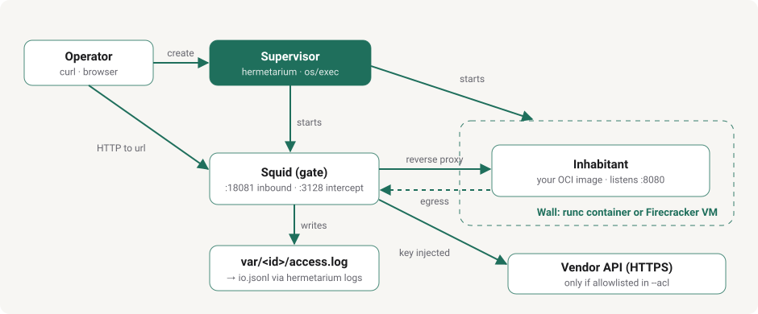

# Inhabitants

An inhabitant is a coding assistant in its own container. [Squid](https://www.squid-cache.org/) is the gate in front of that container. The two `squid.conf` files share one shape. Each file names a different model company.

| Folder | Hermetarium runs | Vendor is | Docker | Firecracker |
| --- | --- | --- | --- | --- |
| [claude-code](claude-code/README.md) | Claude Code | Anthropic, `api.anthropic.com` | tested | tested |
| [grok-build](grok-build/README.md) | Grok Build | xAI, `api.x.ai` | tested | tested |

Both inhabitants have been run on both walls by hand, with a real key: a question, then a second question that continues the conversation. The automated tests use a stand-in model and do not cover that.

## Who is who

**Hermetarium** is the container `create` starts. In `squid.conf` that container is the peer named `inhabitant`. The assistant inside listens on port 8080.

**Vendor** is the model company's API. In `squid.conf` that API is the peer named `vendor`. The container does not call the company by its real name. It calls a stand-in host (`claude.hermetarium.test` or `grok.hermetarium.test`). Squid is the one that connects to the real API.

**Squid** is one gate with two jobs. Your question comes in through `inbound` and is handed to Hermetarium. Hermetarium's call to the model goes out through `vendor`, and Squid attaches the key from `__VENDOR_KEY__` on that trip. The key stays in `squid.conf`.



The two trips through Squid are the same gate.

```
   inbound   you           ---------------->  Hermetarium
   vendor    Hermetarium   ---------------->  the model API, key attached
   closed    Hermetarium   ---------------->  anywhere else
```

## How the gate reaches the Internet

The assistant must not reach the Internet. Squid must. Both walls do this with the network, not with a rule inside the assistant. The assistant is root, so a rule inside it would not hold.

A private address such as `10.98.0.3` cannot talk to the Internet by itself. The host has to rewrite the source address to its own on the way out, and rewrite the reply on the way back. That rewrite is NAT (network address translation). Without it, packets leave and no reply can come back, so the connection hangs. Without NAT, a program cannot get out. With NAT, any program on that network can.

**Docker wall.**

```
   assistant ──▶ gate (Squid) ──▶ Docker's default bridge ──NAT──▶ Internet
        └──────────────┘
        habitat network: --internal, no NAT
```

- Each habitat gets its own network, `htm-<id>`. It is created `--internal`, so Docker drops all traffic between that network and the outside. No NAT is applied to it.
- The assistant sits only on that network. Its default route points at the gate.
- The gate sits on that network and also on Docker's default bridge. The default bridge does NAT. That is the only way out, and Squid is the only program in the gate that uses it.
- In the gate, forwarding is switched off (`iptables -P FORWARD DROP`). Web calls from the assistant's own subnet (port 80, and 443 if you open HTTPS) are redirected into Squid. Anything else the assistant sends dies in the gate.
- The assistant has `NET_ADMIN` and may change its own routes. Pointing its default route at the host bridge reaches nothing, because the network is internal.
- Other containers on the default bridge can reach the gate, but their traffic is not redirected into Squid. They cannot borrow your key.

You need no firewall change on the host. Do not add a masquerade rule for the habitat networks: it would be the only thing that could let an assistant out.

**Firecracker wall.** The virtual machine sits on a TAP device inside a helper container. Squid runs in the same container. The helper forwards nothing (`FORWARD DROP`) and has no NAT rule for the TAP device, and web calls from the machine are redirected into Squid. The machine cannot get out, and Squid reaches the Internet through the helper's own Docker network.

## What every squid.conf shares

[Squid's own guide](https://www.squid-cache.org/Versions/v6/cfgman/) describes each setting. The lines below are the same idea in every inhabitant file.

Squid listens on three ports. One is a plain local port Squid wants open. Port 18081 is `inbound`, your door to the container. Port 3128 catches the container's own web calls.

Logs go to `/log`. `hermetarium logs` prints them. Nothing is cached.

```
acl inbound myport 18081
acl vendorhost dstdomain <the stand-in host>
```

```
cache_peer inhabitant parent 8080 ... name=inhabitant
cache_peer <the model API> parent 443 ... name=vendor
```

The key lines drop any key the container sends, then add yours on the vendor host only:

```
request_header_access x-api-key deny all
request_header_access Authorization deny all
request_header_add x-api-key "__VENDOR_KEY__" vendorhost
request_header_add Authorization "Bearer __VENDOR_KEY__" vendorhost
```

Both files also set `Host` to the real API name on that path (`api.x.ai`, `api.anthropic.com`). The services in front of the APIs answer 403 when the name is still the stand-in host.

The value that replaces `__VENDOR_KEY__` must be an API key. For xAI, a login session token is rejected. For Anthropic, use a long-lived API key: the key is copied into the habitat when you run `create`, and a new key means creating the habitat again. A key that expires while the habitat runs makes every call fail until then.

Replace `__VENDOR_KEY__` in a copy of the file before `create`. Hermetarium copies that file as you wrote it.

These two lines keep every allowed call on a named peer. The model call uses `vendor`. Your question uses `inhabitant`.

```
always_direct deny all
never_direct allow all
```

Then who may pass:

```
http_access allow inbound
http_access allow vendorhost
http_access deny all
```

The container's plain HTTP to the rest of the web is present as comments marked `OPEN-IN` and `OPEN-OUT`. Ordinary HTTPS is the block marked `OPEN-HTTPS`. Squid decrypts those calls, and the assistant does not set a proxy. The gate is an OpenSSL Squid.  Each inhabitant README says which lines to comment in and which to comment out.
