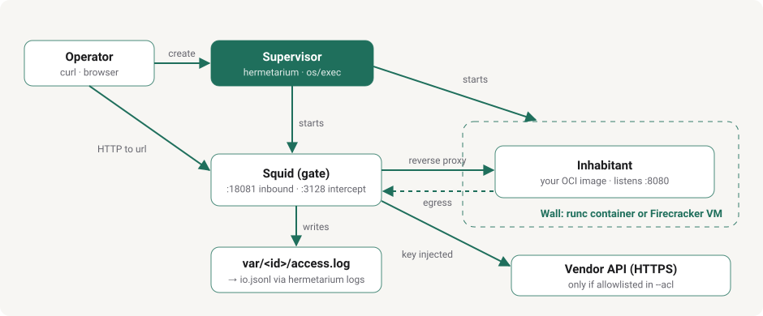

# Inhabitants

An inhabitant lives in its own container. [Squid](https://www.squid-cache.org/) is the gate in front of that container. The Claude and Grok `squid.conf` files share one shape. Each of those files names a model company. The OpenCode file uses the same door and a generic OpenAI-compatible upstream.

| Folder | Hermetarium runs | Vendor is | Docker | Firecracker |
| --- | --- | --- | --- | --- |
| [claude-code](claude-code/README.md) | Claude Code | Anthropic, `api.anthropic.com` | tested | tested |
| [grok-build](grok-build/README.md) | Grok Build | xAI, `api.x.ai` | tested | tested |
| [opencode](opencode/README.md) | OpenCode | the upstream you name, `model.hermetarium.test` | smoke | not in the suite |

Claude Code and Grok Build have been run on both walls by hand, with a real key: a question, then a second question that continues the conversation. The automated tests use a stand-in model and do not cover that. OpenCode is optional. Its smoke is the Docker wall and a pretend model, with no paid key. Echo and agentd stay the images for the wall, egress, and log tests. The terminal setup that boots the OpenCode image on the strong wall is `omakase/opencode-tui/`.

Each official image includes a static day-one guide at `/etc/hermetarium/day-one.md`, copied at build time from [day-one.md](day-one.md). It covers the wall CA, fail-closed egress, nested Docker, and running tests as a non-root user. It does not list a habitat's allowlist.

## Who is who

**Habitat** is what `create` starts: the image on a wall, with the gate in front of it. In `squid.conf` the image is the peer named `inhabitant`. The inhabitant listens on port 8080. Hermetarium is the product, not that container.

**Vendor** is the model company's API. In `squid.conf` that API is the peer named `vendor`. The container does not call the company by its real name. It calls a stand-in host (`claude.hermetarium.test` or `grok.hermetarium.test`). Squid is the one that connects to the real API. OpenCode calls `model.hermetarium.test`. That peer is named `model`, and the gate file names the upstream.

**Squid** is one gate with two jobs. Your question comes in through `inbound` and is handed to Hermetarium. Hermetarium's call to the model goes out through `vendor`, and Squid attaches the key from `__VENDOR_KEY__` on that trip. The key stays in `squid.conf`.



The two trips through Squid are the same gate.

```
   inbound   you           ---------------->  Hermetarium
   vendor    Hermetarium   ---------------->  the model API, key attached
   closed    Hermetarium   ---------------->  anywhere else
```

## How the gate reaches the Internet

The inhabitant must not reach the Internet. Squid must. Both walls do this with the network, not with a rule inside the inhabitant. The inhabitant is root, so a rule inside it would not hold.

A private address such as `10.98.0.3` cannot talk to the Internet by itself. The host has to rewrite the source address to its own on the way out, and rewrite the reply on the way back. That rewrite is NAT (network address translation). Without it, packets leave and no reply can come back, so the connection hangs. Without NAT, a program cannot get out. With NAT, any program on that network can.

**Docker wall.**

```
   inhabitant ──▶ gate (Squid) ──▶ Docker's default bridge ──NAT──▶ Internet
        └──────────────┘
        habitat network: --internal, no NAT
```

- Each habitat gets its own network, `htm-<id>`. It is created `--internal`, so Docker drops all traffic between that network and the outside. No NAT is applied to it.
- The inhabitant sits only on that network. Its default route points at the gate.
- The gate sits on that network and also on Docker's default bridge. The default bridge does NAT. That is the only way out, and Squid is the only program in the gate that uses it.
- In the gate, forwarding is switched off (`iptables -P FORWARD DROP`). Web calls from the inhabitant's own subnet (port 80, and 443 if you open HTTPS) are redirected into Squid. Anything else the inhabitant sends dies in the gate.
- The inhabitant has `NET_ADMIN` and may change its own routes. Pointing its default route at the host bridge reaches nothing, because the network is internal.
- The gate has an address on the default bridge, and Squid listens on all addresses. So the gate also drops everything arriving from the bridge (`iptables -P INPUT DROP`). It accepts only the habitat network, loopback, replies, and, unless you passed `--no-inbound`, your question on port 18081 from the bridge gateway, where the published port arrives. Another container on the default bridge cannot connect to Squid, so it cannot borrow your key. The habitat side is matched by network interface, not address, because a container can forge an address.

You need no firewall change on the host. Do not add a masquerade rule for the habitat networks: it would be the only thing that could let an inhabitant out.

**Firecracker wall.** The microVM sits on a TAP device inside the Firecracker container. The gate is a second container and joins that container's network namespace. The names and the ids are in [Usage](../USAGE.md#two-walls). The Firecracker container forwards nothing (`FORWARD DROP`) and has no NAT rule for the TAP device, and web calls from the machine are redirected into Squid. It also drops everything arriving on its Docker bridge address, except your question on port 18081 from the bridge gateway when inbound is published, so other containers cannot reach Squid. The machine cannot get out, and Squid reaches the Internet through the Firecracker container's own Docker network.

## What every squid.conf shares

[Squid's own guide](https://www.squid-cache.org/Versions/v6/cfgman/) describes each setting. The lines below are the same idea in every inhabitant file.

Squid listens on three ports. One is a plain local port Squid wants open. Port 18081 is `inbound`, your door to the container. Port 3128 catches the container's own web calls.

Logs go to `/log`. `hermetarium logs` prints them. Nothing is cached.

```
acl inbound myportname inbound
acl vendorhost dstdomain <the stand-in host>
```

```
cache_peer inhabitant parent 8080 ... name=inhabitant
cache_peer <the model API> parent 443 ... name=vendor
```

The key lines drop any key the container sends, then add yours on the vendor host only, and not on the inbound port:

```
request_header_access x-api-key deny all
request_header_access Authorization deny all
request_header_add x-api-key "__VENDOR_KEY__" vendorhost !inbound
request_header_add Authorization "Bearer __VENDOR_KEY__" vendorhost !inbound
```

The Claude and Grok files also set `Host` to the real API name on that path (`api.x.ai`, `api.anthropic.com`). The services in front of the APIs answer 403 when the name is still the stand-in host.

The OpenCode file names the stand-in `model.hermetarium.test` and the peer `model`. The words to fill are `__MODEL_PEER__`, `__MODEL_HOST__`, `__MODEL_PREFIX__`, and `__MODEL_KEY__`. Squid drops the box `Authorization` and sets `Bearer` plus the `Host` from that file. A request on the inbound port with that stand-in host never carries the key. The snippets below are the Claude and Grok shape. `inhabitants/opencode/squid.conf` is where that file writes `modelhost` and the `__MODEL_*` words.

The value that replaces `__VENDOR_KEY__` must be an API key. For xAI, a login session token is rejected. For Anthropic, use a long-lived API key: the key is copied into the habitat when you run `create`, and a new key means creating the habitat again. A key that expires while the habitat runs makes every call fail until then.

Replace `__VENDOR_KEY__` in a copy of the file before `create`. Hermetarium copies that file as you wrote it.

These two lines keep every allowed call on a named peer. The model call uses `vendor`. Your question uses `inhabitant`.

```
always_direct deny all
never_direct allow all
```

Then who may pass. A request on the inbound port with the vendor host is denied; it never reaches the vendor and never carries the key:

```
http_access deny inbound vendorhost
http_access allow inbound
http_access allow vendorhost
http_access deny all
```

```
cache_peer_access vendor deny inbound
cache_peer_access vendor allow vendorhost
cache_peer_access vendor deny all
```

The container's plain HTTP to the rest of the web is present as comments marked `OPEN-IN` and `OPEN-OUT`. Ordinary HTTPS is the block marked `OPEN-HTTPS`. Squid decrypts those calls, and the inhabitant does not set a proxy. The gate is an OpenSSL Squid.  Each inhabitant README says which lines to comment in and which to comment out.
